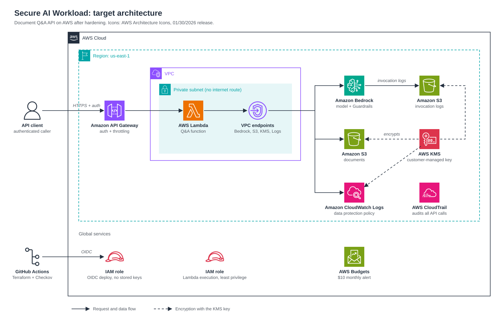

# Threat Model: Secure AI Workload Reference Architecture

**Version:** 1.0 · **Scope:** v1 document Q&A API on AWS · **Framework:** OWASP Top 10 for LLM Applications (2025)

## 1. System overview

A small question-answering API. An authenticated client sends a question; a Lambda function reads a few documents from S3, sends them with the question to a model in Amazon Bedrock, and returns a plain-text answer with source names. No vector database, no agent tools and no fine-tuning in v1.

*Icons: [AWS Architecture Icons](https://aws.amazon.com/architecture/icons/), 01/30/2026 release. Editable source: `architecture.svg`; image copy: `architecture.png`.*

**Trust boundaries:** (1) internet to API Gateway, (2) API Gateway to the VPC, (3) VPC to managed AWS services, (4) CI/CD to the AWS account.

**Assets:** documents in S3, prompts and answers (may contain sensitive data), invocation and application logs, the Lambda execution role, the model budget.

## 2. Threats and controls

| OWASP | Threat in this system | Controls | Enforced by |
| --- | --- | --- | --- |
| LLM01 Prompt Injection | Direct: user tells the model to ignore instructions. Indirect: a poisoned document carries hidden instructions | Guardrails prompt-attack filter; retrieved text clearly separated from instructions; document bucket writable only by the CI role; no tools, so injection cannot trigger actions | Guardrails, app code, Checkov rule |
| LLM02 Sensitive Information Disclosure | Answers expose confidential document content; personal data stored in logs | API authentication; Guardrails personal-data masking; CloudWatch Logs data protection policy; invocation log bucket private and KMS encrypted | Guardrails, Checkov rules |
| LLM03 Supply Chain | Compromised Python package or Terraform module | Pinned versions and lock files; dependency scanning; Bedrock first-party models only | CI pipeline |
| LLM04 Data and Model Poisoning | Documents altered to change answers | S3 versioning; writes only through CI; no fine-tuning in scope | Checkov rule, process |
| LLM05 Improper Output Handling | Model output contains script or markup that a client renders | Return plain text in JSON; clients must encode output; output never passed to an interpreter | App code |
| LLM06 Excessive Agency | Function can do more than answer questions | No tools in v1; role can invoke one model ARN and read one bucket only | Checkov rule (no wildcards) |
| LLM07 System Prompt Leakage | System prompt reveals secrets or internal details | No secrets or configuration in prompts; prompt treated as public | App code, review |
| LLM08 Vector and Embedding Weaknesses | Not applicable: no vector store in v1 | Revisit when retrieval is added in v2 | n/a |
| LLM09 Misinformation | Confident answers not supported by the documents | Answer only from supplied documents; "I don't know" when unsupported; return source names; Guardrails grounding check | App code, Guardrails |
| LLM10 Unbounded Consumption | Request floods or long prompts drive up cost | API throttling and usage plan; Lambda reserved concurrency; max token limits; budget alert | Checkov rule, AWS Budgets |

**Cloud-layer threats (outside the OWASP list)**

| Threat | Controls | Enforced by |
| --- | --- | --- |
| Stolen deployment credentials | GitHub OIDC role, no long-lived access keys | Checkov rule, IAM |
| Data exfiltration or SSRF through outbound network paths | No internet gateway or NAT for the function; access to AWS only through VPC endpoints | Checkov rule |
| Undetected tampering | CloudTrail on; log buckets with restrictive policies | Checkov rule |

## 3. Out of scope for v1

Multi-tenant document isolation, agent tools and actions, vector retrieval, model fine-tuning, and production availability targets.

## 4. Known residual risks

- Guardrails reduce prompt injection but do not eliminate it.
- Personal-data masking relies on pattern detection and can miss unusual formats.
- Sample documents are fictional, so real data classification is untested.
